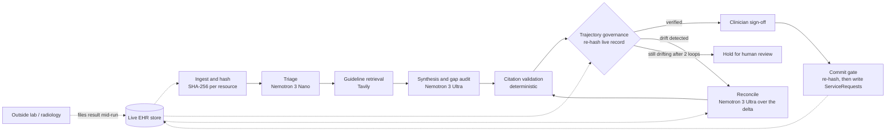

# SynapseFHIR

**Verifiable specialist-referral workups, built on NVIDIA Nemotron and served by Nebius Token Factory.**

SynapseFHIR reads a patient's HL7 FHIR R4 record and the referral order in it. It pulls the target specialty's referral guideline from the live web with Tavily, then drafts a referral memo in which every statement is checked against a real record. It orders only the missing pre-referral workup. Before anything is committed it re-checks the live chart, so a result that arrives mid-run can't cause a duplicate order.

> Built for the NVIDIA x Nebius hackathon. Synthetic patient data only. This is decision support for clinicians, not medical advice.

---

## Why

Up to 30% of specialist consults arrive without the baseline diagnostics the specialist needs, such as a nephrology referral with no urine albumin result or a cardiology consult with no ECG. The consult gets rescheduled, the patient waits, and the slot is wasted. SynapseFHIR closes that gap before the referral is sent, and makes every step auditable:

- **Every claim cites a record.** Each statement in the memo carries the FHIR resource IDs it rests on. Code checks those IDs against the bundle, and anything that doesn't resolve is removed and flagged.
- **Guidelines come from the live web, not hardcoded rules.** Tavily searches the specialty societies that define the standard of care (KDIGO, NKF, ACC/AHA, ADA, Endocrine Society, AAN), NCBI, and the clinical policies of major insurers (Aetna, UnitedHealthcare, Cigna, Anthem, CMS). The checklist lists the sources it was built from, with links.
- **The plan is re-checked before anything is written.** The record is fingerprinted with SHA-256 at the start. If it changes mid-run, the agent re-plans over just the change, and cancels an order only when the cancellation points to a resource that actually changed.

## Architecture



The pipeline is a LangGraph state machine ([pipeline.py](pipeline.py)) with seven nodes:

| # | Node | Engine | What it does |
|---|------|--------|--------------|
| 0 | `ingest` | Deterministic | Reads the bundle from the EHR store. Takes a snapshot: a whole-bundle SHA-256 plus a hash per resource. |
| 1 | `fast_triage` | **Nemotron 3 Nano 30B-A3B** | Reads the full raw bundle and extracts the relevant conditions, labs and medications. Takes the specialty from the referral `ServiceRequest`, or infers it from the primary uncontrolled problem when there is no referral order. Writes two search queries from scratch for each patient: one for clinical society guidelines and one for insurer coverage policy. |
| 2 | `fetch_guidelines` | **Tavily** (`advanced`, two parallel searches) | Searches the society allowlist (4 results) and the payer allowlist (3 results) at the same time, keeping each source's URL and group. A failed payer search never blocks the referral. If the society search fails, falls back to an offline summary for that specialty (KDIGO, ACC/AHA or ADA), clearly flagged in the UI. There is no offline payer fallback: payer requirements only ever come from retrieved documents. |
| 3 | `deep_synthesis` | **Nemotron 3 Ultra 550B-A55B** | Writes the cited referral memo, audits each required lab or imaging study (SATISFIED / MISSING / OUTDATED) and tags whether it comes from the clinical guideline, the payer policy, or both. Flags safety issues and drafts one order per gap. |
| 4 | `validate_citations` | Deterministic | Checks every cited ID against the snapshot, including several IDs in one field. Strips invalid IDs, marks claims VERIFIED / PARTIAL / UNSUPPORTED, and downgrades any "satisfied" checklist item whose evidence doesn't exist. Resets any payer tag to clinical if no payer policy was actually retrieved. |
| 5 | `governance` | Deterministic | Re-hashes the live record and compares it with the snapshot the plan was built on. |
| 6 | `reconcile` | **Nemotron 3 Ultra** | Runs only on drift. Sees just the proposed orders and the added, changed or removed resources, and decides KEEP or CANCEL for each order. |

### Trusted guideline sources

Tavily searches only allowlisted domains (`SOCIETY_DOMAINS` and `PAYER_DOMAINS` in [config.py](config.py)), in two groups:

| Group | Domains | Why |
|-------|---------|-----|
| Clinical specialty societies | kdigo.org, kidney.org (nephrology); acc.org, heart.org, ahajournals.org, jacc.org (cardiology); diabetes.org, diabetesjournals.org, endocrine.org (endocrinology); aan.com (neurology); ncbi.nlm.nih.gov (peer-reviewed literature) | Define the standard of care: which labs and imaging a specialist expects before the first visit. |
| Payer clinical policy and utilization guidelines | aetna.com (Clinical Policy Bulletins), uhcprovider.com (UnitedHealthcare provider guidelines), cigna.com (Medical Coverage Policies), anthem.com (Clinical UM Guidelines), cms.gov (Medicare NCDs and LCDs) | Define what an insurer needs to see before it approves the referral or the tests it requires. A referral that meets the clinical guideline can still be denied or delayed if it's missing the documentation the payer's policy asks for. |

The two groups are searched **separately and in parallel**, each with its own Nano-written query, so payer policies are never crowded out of the results by society guidelines. `PAYER_EXCLUDE_DOMAINS` removes subdomains inside the payer allowlist that never hold coverage policy (`qcor.cms.gov`, which serves facility inspection reports).

In the UI the checklist lists the two groups of sources separately, and any item a payer policy requires carries a **Payer requirement** or **Clinical and payer** tag. Ultra is told to use those tags only when the retrieved payer text states the requirement. The validator enforces the minimum: with no payer document retrieved, no item can carry a payer tag.

### The drift and reconcile loop

This is what stops the agent from acting on a stale picture of the patient:

1. **Detect.** `governance` compares per-resource hashes, so drift is traced to the exact resource IDs that were added, modified or removed.
2. **Re-plan over the delta only.** `reconcile` sends Nemotron Ultra the open orders and only the changed resources, not the whole record again. In the live runs below, re-planning used **79–87% fewer tokens** than the full synthesis (for example, 1,966 vs 9,590 for the nephrology patient).
3. **Check the model's decisions.** A CANCEL is accepted only if its `evidence_resource_id` is one of the changed resources. Anything else is overruled to KEEP and logged as a rejected cancel. When a cancel is accepted, the matching checklist item becomes SATISFIED, citing the new resource.
4. **Loop.** The pipeline goes back through `validate_citations` and `governance` against the new snapshot. If the record keeps changing after 2 reconciliations (`MAX_RECONCILIATIONS` in [config.py](config.py)), every order is held for human review.
5. **Commit gate.** When the clinician approves, `TrajectoryGovernor.commit_orders` re-hashes the record one last time. It writes FHIR `ServiceRequest` resources only if nothing changed since verification; otherwise it refuses and asks for a re-run.

In the **Record changes mid-run** demo scenario, each patient gets a result filed by another system 3 seconds into the run: a urine albumin-to-creatinine ratio (uACR) for the nephrology patient, a 12-lead ECG for the cardiology patient, and an HbA1c for the endocrinology patient. The agent detects the change, cancels only the order the new result makes redundant, and keeps the rest.

## Three specialties, one pipeline

The demo ships three synthetic patients. Their labels in the app are neutral (`pat-maria-02 · 64F`), so the specialty, search query, guideline sources and workup all come from the pipeline, not the UI:

| Patient | Referral | Planted gap | Mid-run result |
|---------|----------|-------------|----------------|
| [`pat-james-01`](sample_bundle.json), 58M | Nephrology: CKD recorded as 3b, eGFR 28, potassium 5.3 on lisinopril | No urine albumin (uACR) | uACR 310 mg/g |
| [`pat-maria-02`](sample_cardio.json), 64F | Cardiology: new exertional chest discomfort, BP 164/96 on lisinopril and amlodipine | No ECG | 12-lead ECG showing LVH |
| [`pat-david-03`](sample_endo.json), 52M | Endocrinology: fasting glucose 238 on metformin and glipizide | No HbA1c | HbA1c 9.6% |

The prompts contain no specialty-specific rules; the only per-specialty text is the offline fallback, which wasn't used here. Here is what each layer produced in live runs of the **Record changes mid-run** scenario on 2026-10-25.

**Searches.** Nemotron Nano wrote both queries for each patient:

| Patient | Society query | Payer query | Society sources | Payer sources |
|---------|---------------|-------------|-----------------|---------------|
| `pat-james-01` | "Nephrology referral guidelines for Chronic kidney disease with declining eGFR and elevated potassium" | "Insurance coverage criteria for Nephrology referral and associated labs (eGFR, potassium) for CKD stage 3b with hyperkalemia" | kdigo.org (2), kidney.org, diabetesjournals.org | cms.gov (2), aetna.com |
| `pat-maria-02` | "Cardiology referral guidelines for exertional chest discomfort with uncontrolled hypertension" | "Insurance coverage for Cardiology referral and workup for exertional chest discomfort with uncontrolled hypertension" | acc.org (2), heart.org, jacc.org | cms.gov (3) |
| `pat-david-03` | "Endocrinology referral criteria: hyperglycemia despite metformin and glipizide" | "Insurance coverage criteria for endocrinology referral for hyperglycemia despite metformin and glipizide" | diabetesjournals.org, ncbi.nlm.nih.gov (3) | cms.gov (2), aetna.com |

**Results.**

| Patient | Gaps Ultra found | Payer-tagged items | Cancelled mid-run | Citations valid |
|---------|------------------|--------------------|-------------------|----------------:|
| `pat-james-01` | Renal ultrasound, hemoglobin, bicarbonate, calcium/phosphate/PTH | None | uACR order, citing `obs-uacr-990` | 6/6 |
| `pat-maria-02` | Troponin, stress testing or coronary CTA | None | ECG order, citing `diag-ecg-990` | 11/11 |
| `pat-david-03` | Urine ACR, dilated eye exam, lipid panel (outdated), blood pressure | HbA1c, urine ACR and dilated eye exam, tagged clinical and payer from CMS quality-measure specifications | HbA1c order, citing `obs-hba1c-990` | 11/11 |

No society guideline appeared in more than one patient's results (one CMS document came back in both the nephrology and cardiology payer searches). Every citation resolved to a real resource, and each mid-run result cancelled exactly one order. Ultra also raised safety findings from each record on its own: a stage 3b label that contradicts an eGFR of 28, an LDL of 162 with no statin, and treatment failure on two oral diabetes drugs.

**What the payer search does and doesn't find.** Insurers publish coverage policies for specific tests, drugs and procedures, plus quality-measure specifications. They rarely publish criteria for referring to a specialist. So the payer search often returns related documents rather than a direct referral rule, and Ultra correctly tagged nothing as payer-driven for two of the three patients. When a payer document does apply, it shows up: the endocrinology run above, and an earlier cardiology run that retrieved UnitedHealthcare's prior-authorization guideline for adult cardiac imaging and tagged blood-pressure documentation as a clinical and payer requirement.

**Run-to-run variation.** Search results differ between runs, and the checklist follows them. In 1 of 3 cardiology runs on 2026-10-25, the society search returned chronic coronary disease material instead of the chest-pain guideline, and the ECG wasn't audited. An endocrinology run in the app surfaced vitamin B12 monitoring on long-term metformin instead of the eye exam.

## Measured telemetry

All numbers below are real measurements from the 2026-10-25 live runs against Nebius Token Factory and Tavily, not estimates. Every run records the same data in the app's telemetry panel and step log.

**Per step, nephrology patient:**

| Step | Engine | Tokens | Latency | Cost (USD) |
|------|--------|-------:|--------:|-----------:|
| Ingest and hash | Deterministic | — | <0.01 s | — |
| Fast clinical triage | Nemotron 3 Nano | 3,413 | 7.8 s | $0.000573 |
| Guideline retrieval | Tavily (4 society + 3 payer, in parallel) | — | 5.1 s | — |
| Deep synthesis and audit | Nemotron 3 Ultra | 9,590 | 12.4 s | $0.009590 |
| Citation validation | Deterministic | — | <0.01 s | 6/6 IDs valid |
| Governance | Deterministic | — | <0.01 s | drift detected (`obs-uacr-990`) |
| Drift reconciliation | Nemotron 3 Ultra | 1,966 | 3.7 s | $0.001966 |
| Citation validation | Deterministic | — | <0.01 s | 6/6 IDs valid |
| Governance | Deterministic | — | <0.01 s | verified |
| **Total** | | **14,969** | **29.1 s** | **$0.012129** |

**Per patient:**

| Patient | Total tokens | Run cost | Same tokens at Ultra rates | Saved by two-model routing | Citations valid |
|---------|------------:|---------:|---------------------------:|---------------------------:|----------------:|
| `pat-james-01` | 14,969 | $0.0121 | $0.0150 | 19.0% | 6/6 |
| `pat-maria-02` | 18,184 | $0.0136 | $0.0182 | 25.2% | 11/11 |
| `pat-david-03` | 20,815 | $0.0167 | $0.0208 | 19.5% | 11/11 |

With both searches running in parallel, the Tavily step took 4.6–5.6 s, compared with 2.8–4.1 s for the single society search on 2026-10-24. Ultra's synthesis step also reads the payer documents now, which is part of why these runs cost more than the 2026-10-24 runs ($0.012–0.017 vs $0.009–0.013).

**Cost of using two models.** Sending triage to Nano saved 19–25% compared with pricing the same tokens at Ultra rates. The saving is modest because the sample bundles have only 6–11 resources. Nano reads the raw record and Ultra reads a short summary, so the saving grows with record size. Real patient histories often run to 100k+ tokens.

**Throughput.** Ultra outran Nano on Token Factory in our runs (about 370 vs about 260–300 tokens/sec). Nano earns its place by being 16× cheaper on input tokens for full-record extraction, not by being faster.

Prices come from Token Factory list rates in [config.py](config.py): Nano costs $0.06 per million input tokens and $0.24 per million output tokens; Ultra costs $1.00 per million for both. Tavily usage is billed in credits and isn't included in the dollar totals.

## Setup

**Requirements:** Python 3.11 or later (for the built-in `tomllib`), a [Nebius Token Factory](https://tokenfactory.nebius.com) API key, and (optionally) a [Tavily](https://app.tavily.com) API key.

```bash
git clone https://github.com/gowravmannem/synapsefhir.git
cd synapsefhir
python -m venv .venv
source .venv/bin/activate        # Windows: .venv\Scripts\activate
pip install -r requirements.txt
```

### API keys

Keys live in TOML, never in the repository.

**Local runs:** copy the template to `config.toml` in the project root and fill in your keys. `config.toml` is git-ignored.

```bash
cp config.toml.example config.toml
```

**Streamlit Community Cloud:** in your app's **Settings → Secrets**, paste the same lines:

```toml
nebius_api_key = "your-nebius-api-key"
tavily_api_key = "your-tavily-api-key"
```

| Key | Required | Purpose |
|-----|----------|---------|
| `nebius_api_key` | Yes | Authenticates calls to Nemotron Nano and Ultra on Token Factory. |
| `tavily_api_key` | Recommended | Live guideline and payer-policy retrieval. Without it, the pipeline uses an offline summary for the patient's specialty (KDIGO, ACC/AHA or ADA) and labels it as such in the UI. |
| `nebius_base_url` | No | Overrides the Token Factory endpoint (default `https://api.tokenfactory.nebius.com/v1/`). |

[settings.py](settings.py) looks each key up in this order: Streamlit secrets (Cloud, or a local `.streamlit/secrets.toml`), then `config.toml`, then an environment variable of the same name in upper case (for Docker or CI). Key names match regardless of case.

Model IDs, prices, trusted guideline domains and the reconciliation limit are all in [config.py](config.py).

### Run

```bash
python -m streamlit run app.py
```

Open http://localhost:8501, pick a patient and a scenario, and click **Run agent**:

- **Standard referral:** the patient's record is stable. The agent audits the workup, drafts orders and waits for sign-off.
- **Record changes mid-run:** a new result (uACR, ECG or HbA1c, depending on the patient) lands while the agent is working. Watch the progress bar go through Governance (drift) → Reconcile → Validate → Governance, and see the duplicate order struck through.

Click **Approve and place orders** to pass the final record check and write `ServiceRequest` resources into the record.

### Tests

The offline test suite drives the real LangGraph pipeline with a fake Token Factory client, so it needs no keys and costs nothing:

```bash
python tests/test_pipeline.py
```

It covers:
- the clean path
- drift detection and reconciliation
- rejection of a CANCEL backed by evidence that didn't change
- stripping of a hallucinated citation
- the retry when a reply fails schema validation
- the commit gate refusing to write after a late change
- every sample patient being well formed, with a drift event the governor detects as a new resource
- the offline fallback guideline following the inferred specialty
- society and payer searches running separately, with sources tagged by group, a failed payer search not blocking the run, and the society fallback keeping the payer sources (using a fake Tavily client)
- a payer tag being reset to clinical when no payer policy was retrieved
- several evidence IDs in one checklist field all having to resolve
- the API-key lookup order (Streamlit secrets, then `config.toml`, then environment variables), with a fake `st.secrets`

## Project structure

| File | Purpose |
|------|---------|
| [app.py](app.py) | Streamlit app: patient and scenario pickers, live progress bar, results, order sign-off. |
| [ui.py](ui.py) | HTML/CSS builders for the dashboard: memo with two-way citation hover, checklist, orders panel, metrics. |
| [pipeline.py](pipeline.py) | LangGraph state machine and all seven nodes. |
| [governance.py](governance.py) | Snapshots, per-resource diffs, reconciliation checks, commit gate. |
| [validation.py](validation.py) | Deterministic citation validator. |
| [llm.py](llm.py) | Token Factory client and schema-validated calls with retry. |
| [telemetry.py](telemetry.py) | Per-step tokens, latency, throughput, per-model cost and the Ultra-only comparison. |
| [ehr_store.py](ehr_store.py) | Thread-safe in-memory FHIR store that other systems can write to mid-run. |
| [schemas.py](schemas.py) | Pydantic v2 schemas for every model output. |
| [fhir_utils.py](fhir_utils.py) | FHIR reference normalization and the compact resource index. |
| [scenarios.py](scenarios.py) | The demo patients and the mid-run drift event for each. |
| [config.py](config.py) | Model IDs, pricing, society and payer domain allowlists, result counts, limits. |
| [settings.py](settings.py) | API-key lookup: Streamlit secrets, then local `config.toml`, then environment variables. |
| [config.toml.example](config.toml.example) | Template for the git-ignored `config.toml` that holds API keys locally. |
| [sample_bundle.json](sample_bundle.json) | Nephrology patient: CKD recorded as stage 3b, eGFR 28, potassium 5.3, on lisinopril; no uACR. |
| [sample_cardio.json](sample_cardio.json) | Cardiology patient: new exertional chest discomfort, BP 164/96 on lisinopril and amlodipine; no ECG. |
| [sample_endo.json](sample_endo.json) | Endocrinology patient: type 2 diabetes with fasting glucose 238 on metformin and glipizide; no HbA1c. |

## Limitations

- **Three synthetic patients.** They show the pipeline generalizes across specialties, but they're small hand-built records, not a benchmark.
- **Specialty inference is the fragile step.** Without a referral order, Nano routed the endocrinology patient to Cardiology (pulled by an elevated LDL) in one run. When a "primary uncontrolled problem" rule was added, it routed the cardiology patient to Nephrology (pulled by the hypertension). Real EHRs carry the referral as a `ServiceRequest`, so SynapseFHIR treats that as the source of truth and only infers the specialty when it's absent.
- **Mock EHR.** `MockEHRStore` stands in for a FHIR server. Pointing it at a HAPI FHIR endpoint would mean re-implementing `read_bundle` and `write_resource`, and keying citations on `Type/id`, because servers like HAPI assign IDs per resource type.
- **Small-record economics.** The routing saving measured here (19–25%) reflects 6–11-resource bundles. It hasn't yet been benchmarked on large Synthea records.
- **Search results vary between runs.** The checklist is only as good as the documents Tavily returns, and those change from run to run (see the cardiology ECG example above).
- **Payer coverage is thin.** Insurers rarely publish rules for referring to a specialist, so the payer search usually finds coverage policies for tests or drugs, or nothing that applies. Searching payer policy for each *proposed order* (for example, coverage criteria for a stress echo) would likely be a better fit than searching for the referral.
- **The validator checks that evidence exists, not that it supports the claim.** In one run, Ultra marked "creatinine clearance <60" as satisfied by an eGFR of 96, and treated a clinical trial's enrollment criteria as requirements. A prompt rule now rules out both, and those runs came back clean, but no code checks values against thresholds.
- **The guideline audit is model-judged.** Whether something is MISSING relies on Ultra reading the full resource index.

## License

[MIT](LICENSE)
